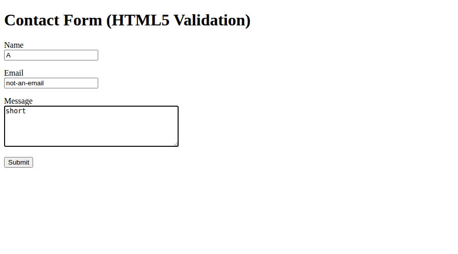
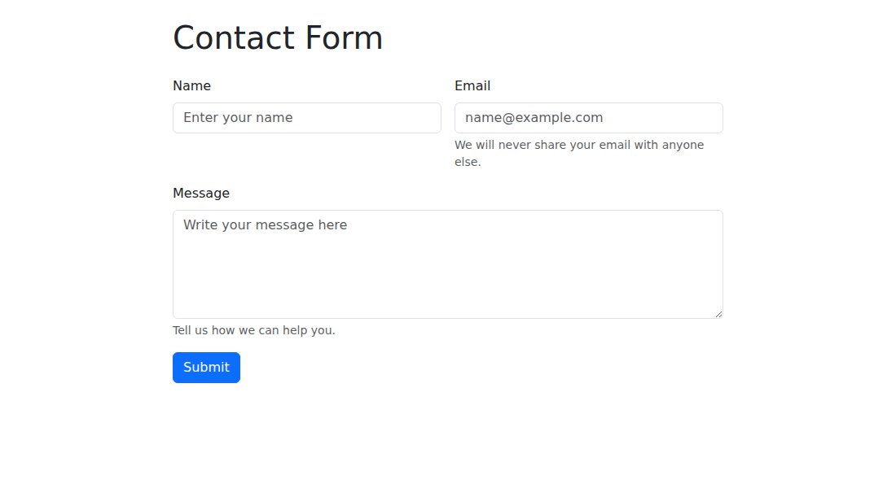
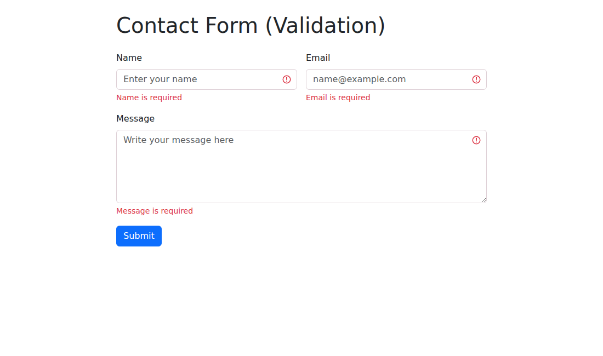
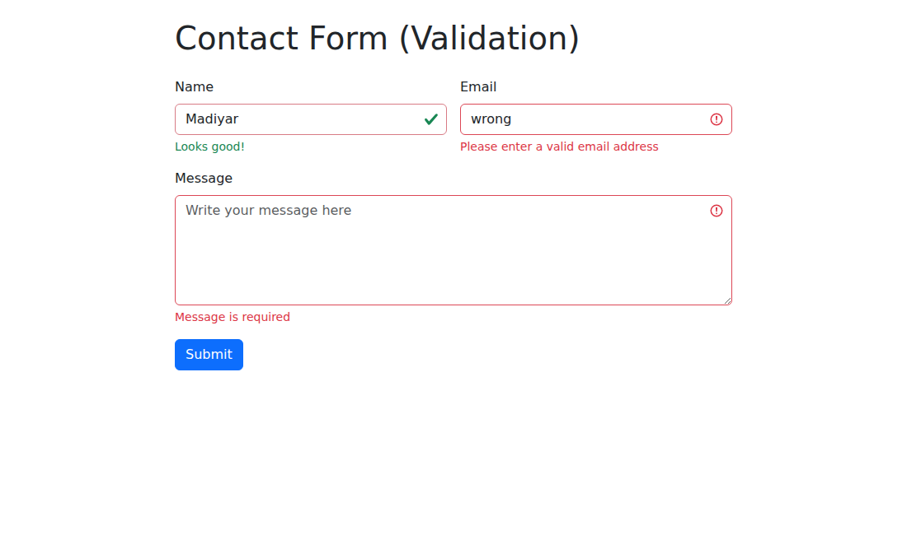
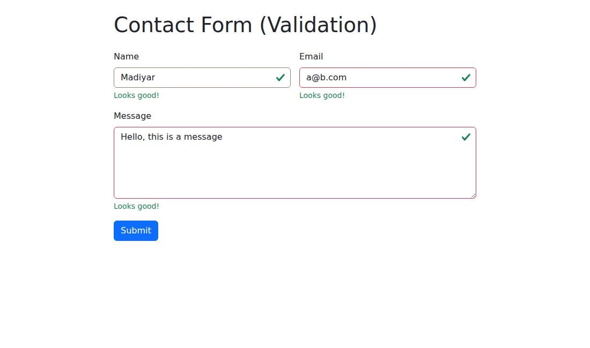
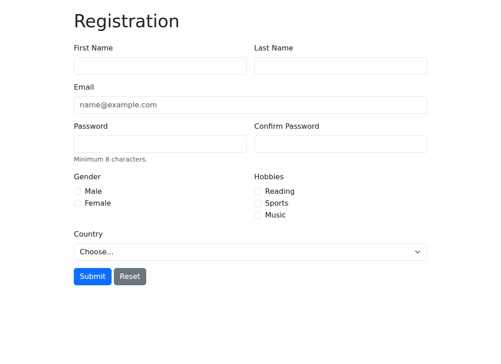
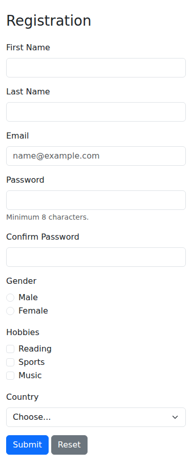
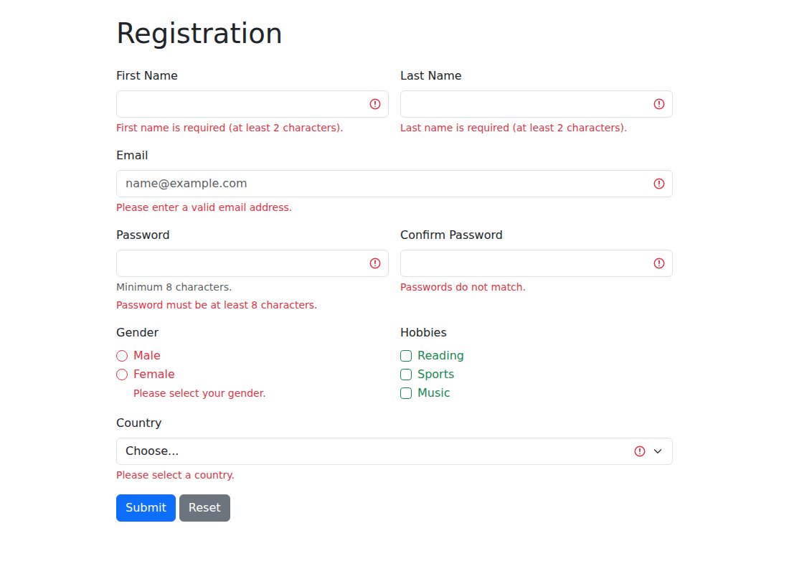
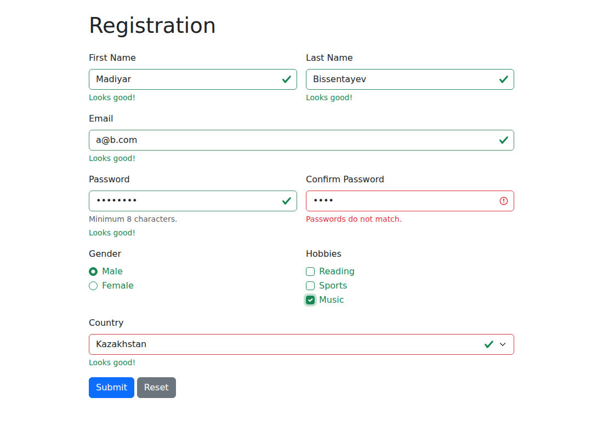
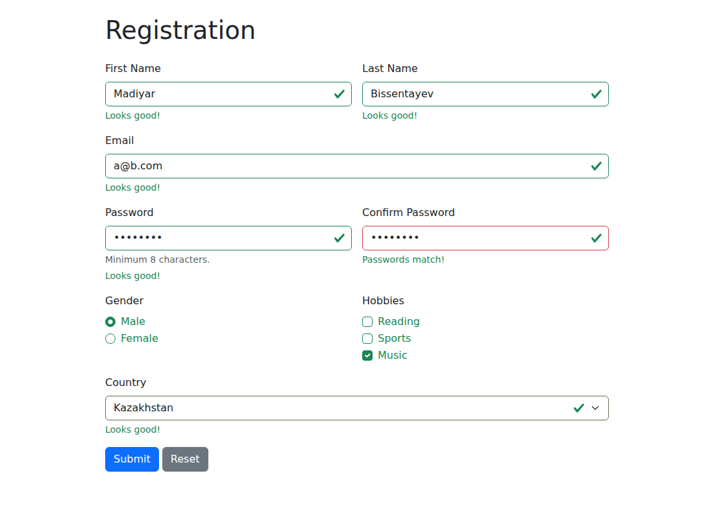

# Assignment 4. Forms and Validation

**Name:** Bissentayev Madiyar
**Group:** Your Group

---

## Part 1. Basic HTML Forms

### Task 0. Simple Contact Form
Create a basic contact form with the following fields: Name (text input), Email (email input), Message (textarea), Submit button. Ensure all fields have proper `<label>` elements.

File: `task0.html`

### Task 1. Form with HTML5 Validation
Add built-in validation attributes (`required`, `type`, `maxlength`, etc.). Test how the browser enforces validation (e.g., email format, empty fields).

File: `task1.html`

Attributes used: `required` on all fields, `type="email"` for the email, `minlength`/`maxlength` for the name and message.

Test results: the browser blocks the submit and shows a message when a field is empty, when the email has no `@`, and when the text is shorter than `minlength`.

---

## Part 2. Bootstrap Forms

### Task 2. Bootstrap Form Styling
Recreate the contact form using Bootstrap form classes. Use Bootstrap's grid system to arrange form fields neatly. Add placeholders and helper text where appropriate.

File: `task2.html`

Desktop:

Mobile:

### Task 3. Bootstrap Validation Styles
Apply Bootstrap's validation feedback classes (`is-valid`, `is-invalid`). Show feedback messages below inputs (e.g., "Email is required", "Looks good!"). Test the form by entering valid and invalid data.

File: `task3.html`

Empty form submitted:

Valid name, invalid email:

All data valid:

---

## Part 3. Advanced Form Project

### Task 4. Registration Form
Create a registration form with: First Name, Last Name, Email, Password + Confirm Password, Gender (radio buttons), Hobbies (checkboxes), Country (select dropdown), Submit and Reset buttons. Style the form with Bootstrap Grid so it is responsive. Add HTML5 validation (e.g., password must have minimum length). Add Bootstrap validation feedback to display error/success messages.

File: `task4.html`

Desktop:

Mobile:

Empty form submitted:

Passwords do not match:

All data valid:

---

## Summary of my work process

In Task 0 I created a basic contact form and connected every input to a `<label>` using `for` and `id`. In Task 1 I added HTML5 validation attributes (`required`, `type="email"`, `minlength`, `maxlength`) and tested how the browser blocks invalid data. In Task 2 I rebuilt the form with Bootstrap classes (`form-label`, `form-control`, `form-text`) and arranged the fields with the grid (`row`, `col-md-6`). In Task 3 I added `novalidate` and a small script that checks each field with `checkValidity()` and sets `is-valid` or `is-invalid`, with messages in `valid-feedback` and `invalid-feedback`. In Task 4 I combined everything in a registration form: radio buttons, checkboxes, a select, a password with `minlength="8"`, a check that both passwords match, and Bootstrap's `was-validated` class to show feedback. The Reset button clears the form and the validation styles.
